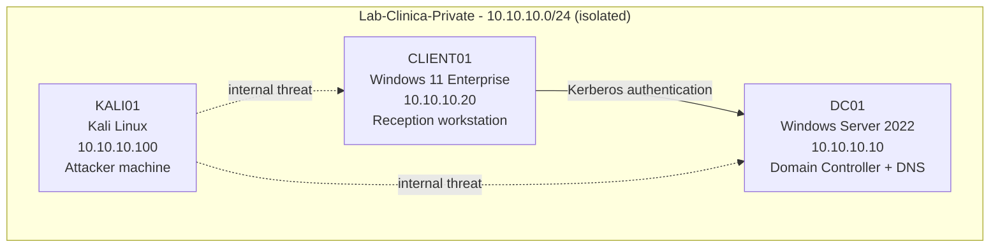

# Active Directory Attack & Defense Home Lab

A hands-on home lab that builds a small Active Directory domain for a fictional
medical clinic, then studies it from a **defender's (SOC) point of view**:
simulating common AD attack techniques in order to learn how to **harden** the
domain and **detect** malicious activity in the logs.

Built on Hyper-V as part of my IFTS course in networking/cybersecurity. This is
the second project in my portfolio, focused on the skills required for an entry
SOC analyst role.

> **Scope & ethics:** everything runs inside an **isolated virtual network**
> with no connection to any production or home network. All hosts, users and
> data are fictional. The goal is defensive learning (blue/purple team).

---

## Scenario

**Clinica San Giorgio** — a small outpatient medical clinic (~20 employees:
reception, doctors, administration). A single Active Directory domain manages
accounts and access. Patient data is highly sensitive and healthcare providers
are a frequent ransomware target, which is what justifies taking detection and
hardening seriously.

---

## Lab architecture

Isolated network **10.10.10.0/24** (Hyper-V *Private* switch, no gateway).

| Host | OS | Role |
|------|----|----|
| **DC01** | Windows Server 2022 (Eval) | Domain Controller + DNS — `sangiorgio.internal` |
| **CLIENT01** | Windows 11 Enterprise (Eval) | Domain-joined reception workstation |
| **KALI01** | Kali Linux | Attacker on the internal network |

Host: Intel i7-12700K, 32 GB RAM, Windows 11 Pro + Hyper-V.

---

## What this lab covers

- [x] Domain Controller build: static addressing, DNS, promotion to DC
- [x] Domain structure: OUs, security groups, user accounts (least privilege)
- [x] Domain-joined client and verified domain logon
- [x] Security logging baseline: advanced audit policy via GPO
- [ ] Attack techniques simulation (reconnaissance, credential attacks, lateral movement)
- [ ] Hardening
- [ ] Detection & monitoring

Each attack topic is paired with **what the defender sees in the logs** and
**how to reduce the risk**.

---

## Documentation

The full step-by-step write-up (in Italian) lives in [`docs/`](docs/):

1. [Panoramica e scenario](docs/01-panoramica-scenario.md)
2. [Architettura del lab](docs/02-architettura-lab.md)
3. [Costruzione del Domain Controller](docs/03-domain-controller.md)
4. [Popolamento del dominio](docs/04-popolamento-dominio.md)
5. Simulazione delle tecniche di attacco *(in corso)*
6. Hardening e difesa *(in corso)*
7. [Detection e logging](docs/07-detection-logging.md)
8. Lezioni imparate *(in corso)*

---

## Key skills demonstrated

- Active Directory design and administration (PowerShell-first)
- Windows networking and DNS troubleshooting
- Security logging and Windows Event Log analysis (Event IDs, log correlation)
- Group Policy (GPO) configuration
- Blue/purple-team methodology: attack → detect → harden

---

*Author: Andrei Nicolae Telea — [github.com/andreitelea](https://github.com/andreitelea)*
