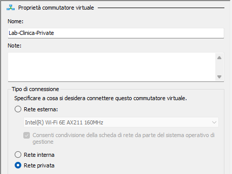
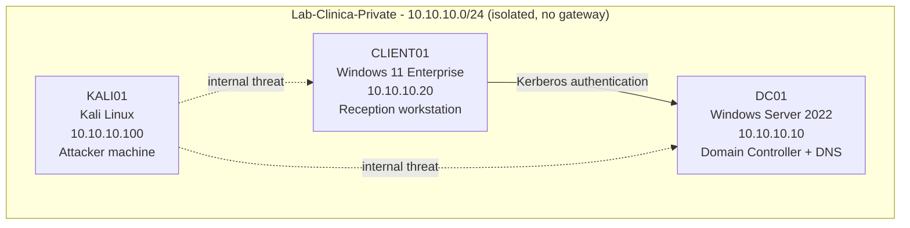
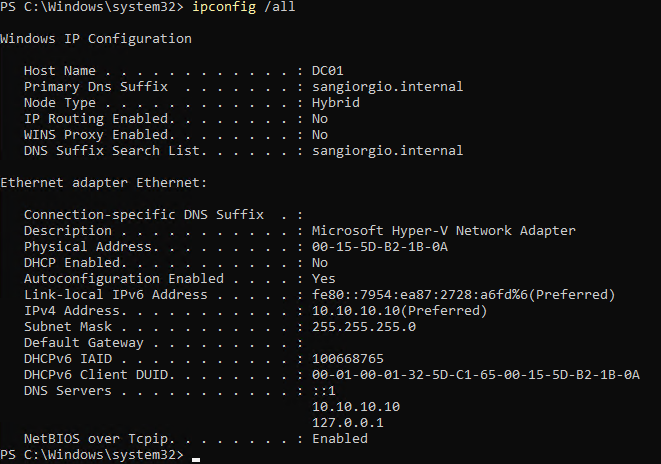

# 2. Lab Architecture

## Virtualization platform

The lab runs on **Hyper-V**, the Type-1 hypervisor built into Windows 11 Pro.

- **Host:** Intel i7-12700K, 32 GB RAM, Windows 11 Pro, two NVMe SSDs.
- **Why Hyper-V:** it is a native, enterprise-grade hypervisor, it costs nothing
  on Windows Pro, and it integrates cleanly with the Windows Server / AD stack
  this lab is built on.

## Isolated network

All three VMs sit on a single **isolated** virtual network so that attack
traffic can never reach the host or the home LAN.

- **Virtual switch:** `Lab-Clinica-Private`, of type **Private** — connects the
  VMs to each other only, with no path to the host or the internet.
- **Subnet:** `10.10.10.0/24`, a single flat network with **no default
  gateway**. A flat subnet is realistic for a clinic of this size, and the
  absence of a gateway reinforces the isolation.

Internet access (needed occasionally, mainly to update Kali's tooling) is granted
by *temporarily* attaching an External switch, then removing it to return the
lab to isolation.

## Hosts

| Host | OS | IP | DNS | Role |
|------|----|----|-----|------|
| **DC01** | Windows Server 2022 (Eval) | 10.10.10.10 (static) | 10.10.10.10, 127.0.0.1 | Domain Controller + DNS |
| **CLIENT01** | Windows 11 Enterprise (Eval) | 10.10.10.20 (static) | 10.10.10.10 | Reception workstation (domain-joined) |
| **KALI01** | Kali Linux | 10.10.10.100 (static) | 10.10.10.10 | Attacker machine |

Each host is configured with a static address and points its DNS at the Domain
Controller. The output below confirms DC01's configuration:

## Key design decisions

- **Generation 2 VMs (UEFI).** Modern firmware, required by current Windows
  Server and Windows 11. Secure Boot stays on for the Windows hosts; it is
  disabled only on Kali, which otherwise would not boot.
- **Windows 11 Enterprise for the client.** Windows 10 is out of support
  (October 2025), and the Home edition cannot join a domain — Enterprise mirrors
  a real corporate workstation.
- **Static addressing.** Servers and lab endpoints use fixed IPs for
  predictability. (In production, clients would normally receive their address
  from DHCP.)
- **DNS points at the Domain Controller — the golden rule.** Active Directory
  depends entirely on DNS: clients locate the DC through the SRV record
  `_ldap._tcp.dc._msdcs.sangiorgio.internal` that DC01 publishes. Every client's
  DNS must therefore be the DC, never the home router. A misconfigured DNS is
  the single most common cause of domain-join failures.
- **`.internal` domain suffix.** In 2024 ICANN reserved `.internal` for private
  networks, so it will never collide with a real internet domain. The legacy
  `.local` suffix is avoided because it is reserved for mDNS/Bonjour.
- **Time synchronization.** All hosts use the `W. Europe Standard Time` zone.
  Kerberos rejects authentication when clocks differ by more than 5 minutes, so
  consistent time is a hard requirement, not a nicety.

## Snapshots (checkpoints)

Hyper-V checkpoints are taken at each milestone, so the lab can be rolled back
after destructive tests.

> **Important:** DC01 and CLIENT01 must be rolled back **together**. A
> domain-joined machine and its DC share a secret (the computer account
> password, rotated automatically). Restoring only one of them breaks that
> secret and produces the error *"The trust relationship between this
> workstation and the primary domain failed."*
