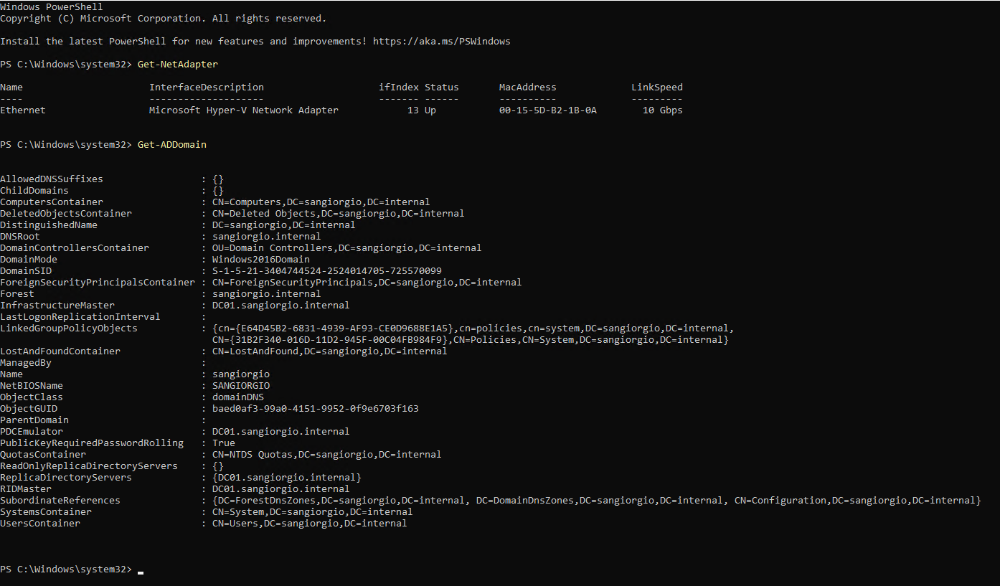

# 3. Domain Controller Build

This chapter covers how **DC01** went from a fresh Windows Server install to the
first (and only) Domain Controller of `sangiorgio.internal`. Every step is shown
as a **PowerShell** command, so the build is documented, repeatable and easy to
review.

## Base installation

| Setting | Value |
|---------|-------|
| OS | Windows Server 2022 Standard (Evaluation), Desktop Experience |
| VM | Generation 2 (UEFI, Secure Boot on) |
| CPU / RAM | 2 vCPU, 4 GB **static** memory |
| Disk | 60 GB |
| Network | `Lab-Clinica-Private` |

- **Static memory instead of Dynamic Memory.** A Domain Controller is the heart
  of the domain; it should not have RAM taken away by the hypervisor under
  pressure.
- **Desktop Experience instead of Server Core.** Chosen for learning, because the
  graphical consoles (Event Viewer, ADUC, Group Policy Management) are useful
  while studying. In production a DC would ideally run **Server Core**: no
  desktop means fewer components, fewer patches and a smaller attack surface.

## Pre-promotion configuration

A server must have a stable identity **before** it becomes a Domain Controller:
renaming a DC or changing its IP afterwards is possible but risky, because the
name and address are registered in DNS and in Active Directory itself.

**1. Computer name** — the random default name is replaced with a meaningful one:

```powershell
Rename-Computer -NewName "DC01" -Restart
```

**2. Static IP address** — no default gateway, since the lab network is isolated:

```powershell
Get-NetAdapter                       # find the adapter name (InterfaceAlias)
New-NetIPAddress -InterfaceAlias "Ethernet" -IPAddress 10.10.10.10 -PrefixLength 24
```

**3. DNS servers** — the DC will host DNS for the domain, so it points to itself:
its own IP first, loopback as a fallback.

```powershell
Set-DnsClientServerAddress -InterfaceAlias "Ethernet" -ServerAddresses 10.10.10.10, 127.0.0.1
```

**4. Time zone** — Kerberos tolerates at most 5 minutes of clock difference, and
the DC is the time reference for the whole domain:

```powershell
Set-TimeZone -Id "W. Europe Standard Time"
```

## Installing the AD DS role

Installing the **Active Directory Domain Services** role only copies the
binaries; the server is not yet a Domain Controller.

```powershell
Install-WindowsFeature AD-Domain-Services -IncludeManagementTools
```

`-IncludeManagementTools` adds the admin consoles and the `ActiveDirectory`
PowerShell module used throughout the rest of the lab.

## Promotion: creating a new forest

Since this is the first DC, the promotion creates a brand-new **forest**, whose
first domain is `sangiorgio.internal`. The same promotion can be run from the
Server Manager wizard (*Promote this server to a domain controller*), which
executes the equivalent of this command behind the scenes:

```powershell
Install-ADDSForest `
    -DomainName "sangiorgio.internal" `
    -DomainNetbiosName "SANGIORGIO" `
    -ForestMode "WinThreshold" `
    -DomainMode "WinThreshold" `
    -InstallDns `
    -SafeModeAdministratorPassword (Read-Host -AsSecureString "DSRM password")
```

| Parameter | Meaning |
|-----------|---------|
| `-DomainName` | DNS name of the domain (see chapter 2 for why `.internal`) |
| `-DomainNetbiosName` | Short legacy name, shown as `SANGIORGIO\user` |
| `-ForestMode` / `-DomainMode` | Functional level `WinThreshold` = Windows Server 2016, the highest level available on Server 2022 |
| `-InstallDns` | Installs the DNS Server role and creates the AD-integrated zone |
| `-SafeModeAdministratorPassword` | Password for **DSRM** (Directory Services Restore Mode) |

The **DSRM password** belongs to a local recovery account used to boot the DC in
repair mode when Active Directory itself is broken. It is a separate,
high-value credential: in a real environment it would be stored in a password
vault, not reused anywhere else.

The server restarts automatically at the end of the promotion.

## Post-promotion checks

After the reboot, the logon screen shows `SANGIORGIO\Administrator`, and the
domain can be queried with the `ActiveDirectory` module:

```powershell
Get-ADDomain
```



Key fields to check in the output:

- `DNSRoot` = `sangiorgio.internal` and `NetBIOSName` = `SANGIORGIO`
- `DomainMode` = `Windows2016Domain`
- `PDCEmulator`, `RIDMaster`, `InfrastructureMaster` = `DC01.sangiorgio.internal`
  — the three domain-level **FSMO roles**. The two forest-level roles (Schema
  Master, Domain Naming Master) are shown by `Get-ADForest`; being the only DC,
  DC01 holds all five

The network configuration after promotion (static IP, DNS pointing to the DC
itself) is shown in [chapter 2](02-lab-architecture.md).

## Administrative accounts

- The built-in **`Administrator`** account (SID ending in **-500**) is kept only
  as an emergency / break-glass account. It is a well-known target for attackers
  because its SID is predictable, and by default it is exempt from UAC.
- Day-to-day administration uses a **personal admin account**, `adm.andre`,
  member of *Domain Admins* (see chapter 4). Separate,
  named admin accounts make every privileged action traceable in the logs to a
  specific person.

## Checkpoint

A Hyper-V checkpoint is taken once the DC is verified, so the lab can always
return to a clean, freshly promoted domain.

## Security notes for later chapters

The build is intentionally "default" in a few places. These points are revisited
in the **Hardening** chapter:

- **Single Domain Controller** — no redundancy: if DC01 fails, the whole domain
  stops working. A real clinic should have at least two DCs.
- **Desktop Experience** on a DC — larger attack surface than Server Core.
- **NetBIOS over TCP/IP** is still enabled — a legacy protocol abused by
  name-poisoning attacks.
- **`ms-DS-MachineAccountQuota` = 10** (default) — any authenticated user can
  join up to 10 computers to the domain.
