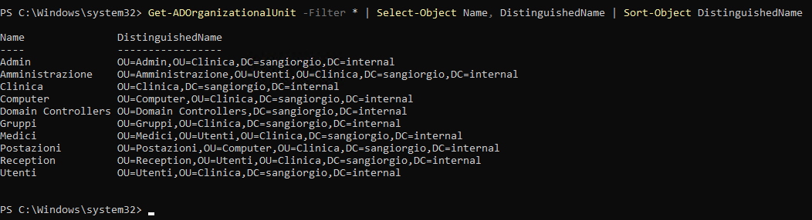
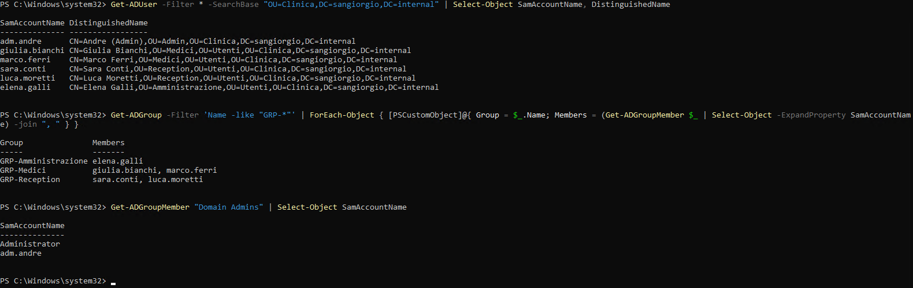
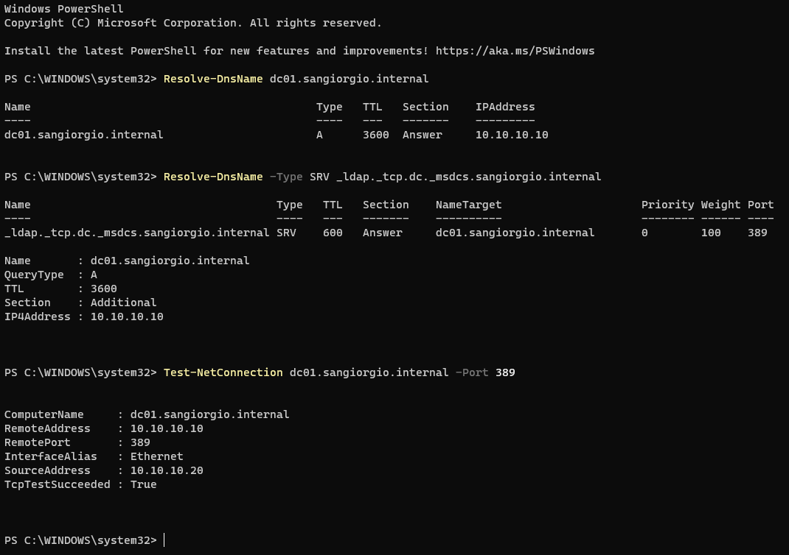
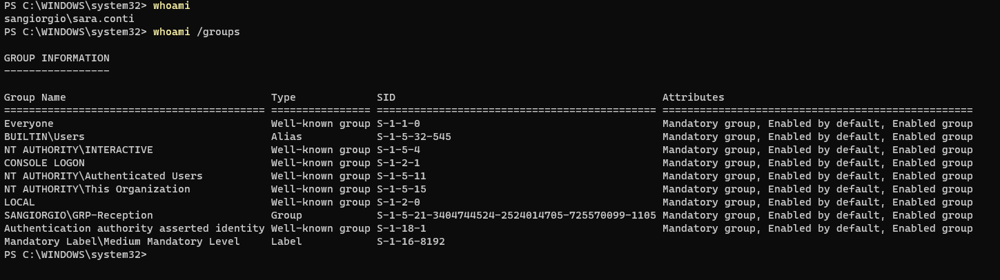

# 4. Domain Structure & Accounts

With the Domain Controller in place (see [chapter 3](03-domain-controller.md)),
the next step is to organize what lives **inside** the domain: organizational
units, security groups, user accounts and the first domain-joined workstation.

The clinic is Italian, so OU and group names are in Italian. The table below
gives the translation:

| Name | Meaning |
|------|---------|
| Clinica | Clinic (root OU) |
| Utenti | Users |
| Medici | Doctors |
| Reception | Front desk |
| Amministrazione | Administration / back office |
| Computer → Postazioni | Computers → Workstations |
| Gruppi | Groups |
| Admin | Administrative accounts |

## Organizational Units

All clinic objects live under a single root OU, `Clinica`, instead of the
default `Users` and `Computers` containers.

```
sangiorgio.internal
├── Domain Controllers          (created automatically)
└── Clinica
    ├── Utenti
    │   ├── Medici
    │   ├── Reception
    │   └── Amministrazione
    ├── Computer
    │   └── Postazioni          (CLIENT01)
    ├── Gruppi                  (GRP-Medici, GRP-Reception, GRP-Amministrazione)
    └── Admin                   (adm.andre)
```

Why this layout:

- **Group Policy targeting.** GPOs can be linked to an OU, so separating users
  from computers (and workstations from servers) makes it possible to apply
  different policies to each.
- **The default containers cannot hold GPOs.** `CN=Users` and `CN=Computers` are
  containers, not OUs, so no GPO can be linked to them directly.
- **Admin accounts are kept apart.** A dedicated `Admin` OU makes privileged
  accounts easy to find, audit and protect with stricter policies.

The structure can be created in PowerShell, for example:

```powershell
$base = "DC=sangiorgio,DC=internal"
New-ADOrganizationalUnit -Name "Clinica" -Path $base
New-ADOrganizationalUnit -Name "Utenti"  -Path "OU=Clinica,$base"
New-ADOrganizationalUnit -Name "Medici"  -Path "OU=Utenti,OU=Clinica,$base"
# ...and so on for the remaining OUs
```

New OUs are protected from accidental deletion by default.

The result, listed with `Get-ADOrganizationalUnit`:



## Security groups and user accounts

### Role-based groups

Permissions are never assigned to individual users. Each department has a
**Global Security** group (`GRP-Medici`, `GRP-Reception`,
`GRP-Amministrazione`), and users receive access by being members of their
department's group. When a new doctor joins, adding them to `GRP-Medici` is
enough; when someone leaves, removing them revokes everything at once.

### Users

| User | Department | OU / group |
|------|------------|------------|
| `giulia.bianchi` | Doctor | Medici / GRP-Medici |
| `marco.ferri` | Doctor | Medici / GRP-Medici |
| `sara.conti` | Front desk | Reception / GRP-Reception |
| `luca.moretti` | Front desk | Reception / GRP-Reception |
| `elena.galli` | Administration | Amministrazione / GRP-Amministrazione |

- Logon names follow the `firstname.lastname` convention.
- Every account is created with a temporary password and **must change it at
  first logon**, so the administrator never knows the user's real password.

Equivalent PowerShell for one user:

```powershell
New-ADUser -Name "Sara Conti" -GivenName "Sara" -Surname "Conti" `
    -SamAccountName "sara.conti" `
    -UserPrincipalName "sara.conti@sangiorgio.internal" `
    -Path "OU=Reception,OU=Utenti,OU=Clinica,DC=sangiorgio,DC=internal" `
    -AccountPassword (Read-Host -AsSecureString "Temporary password") `
    -ChangePasswordAtLogon $true -Enabled $true

Add-ADGroupMember -Identity "GRP-Reception" -Members "sara.conti"
```

### Administrative account

`adm.andre` is a **separate, personal admin account**, stored in the `Admin` OU
and member of *Domain Admins*. In a real environment the same person would also
have a normal account for email and browsing: privileged credentials are used
only for administration, which limits how often they are exposed.

The verification below shows users and their OUs, the members of each
department group, and the members of *Domain Admins*: only the built-in
`Administrator` and `adm.andre`. No clinic user holds administrative rights.



## Joining CLIENT01 to the domain

### Prerequisites: DNS first

Before joining, the workstation must be able to:

1. **Resolve the DC's name** — A record `dc01.sangiorgio.internal` → `10.10.10.10`
2. **Find the Domain Controller** — SRV record
   `_ldap._tcp.dc._msdcs.sangiorgio.internal`, which DC01 publishes
   automatically
3. **Reach the DC** — TCP port **389** (LDAP) open

All three checks pass from CLIENT01, run as a standard domain user:



### The join

Equivalent PowerShell, run on CLIENT01:

```powershell
Add-Computer -DomainName "sangiorgio.internal" `
    -OUPath "OU=Postazioni,OU=Computer,OU=Clinica,DC=sangiorgio,DC=internal" `
    -Credential SANGIORGIO\adm.andre -Restart
```

The computer account `CLIENT01` ends up in the `Postazioni` OU, where
workstation policies will apply. After the join, DC01 and CLIENT01 share a
secret (the computer account password), which is why the two VMs are always
rolled back together (see [chapter 2](02-lab-architecture.md)).

## Verified domain logon as a standard user

`sara.conti` signs in to CLIENT01 with her domain credentials.

- **Hyper-V basic session only.** The enhanced session uses Remote Desktop
  (RDP), and Sara is not allowed to log on through RDP — only administrators
  are. The denied attempt is the expected behavior: least privilege working as
  designed.
- **The access token.** At logon the DC issues Sara a token listing who she is
  and which groups she belongs to; Windows checks this token on every access.
  `whoami /groups` shows it:



Two lines matter:

- `SANGIORGIO\GRP-Reception` — her department group is in the token.
- `Mandatory Label\Medium Mandatory Level` — she runs as a **standard user**.
  A process running with administrative rights would show *High Mandatory
  Level* instead.

## Security notes for later chapters

These weaknesses are left in place on purpose and revisited in the
**Hardening** chapter:

- **Same temporary password for every new user** — anyone who learns it can
  log in as any user who has not yet changed it.
- **Domain join performed with a Domain Admin account** — better practice is a
  dedicated account delegated only the right to join computers to the
  `Postazioni` OU.
- **`ms-DS-MachineAccountQuota` = 10** — any authenticated user can add up to
  10 computers to the domain.
- **Domain Admins are local administrators on every workstation** — a Domain
  Admin logging on to a compromised PC exposes the most powerful credentials
  in the domain.
- **No LAPS** — the local administrator password is not randomized per
  machine.
